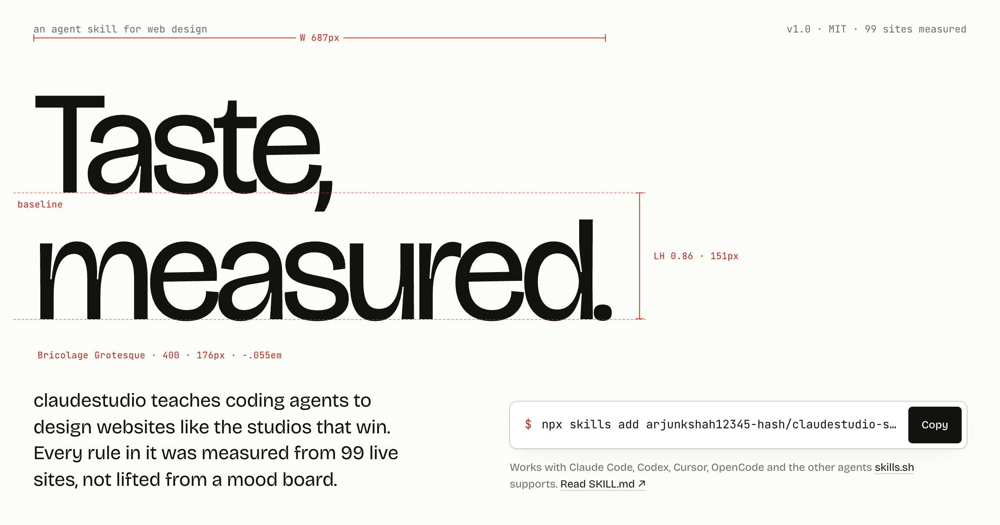
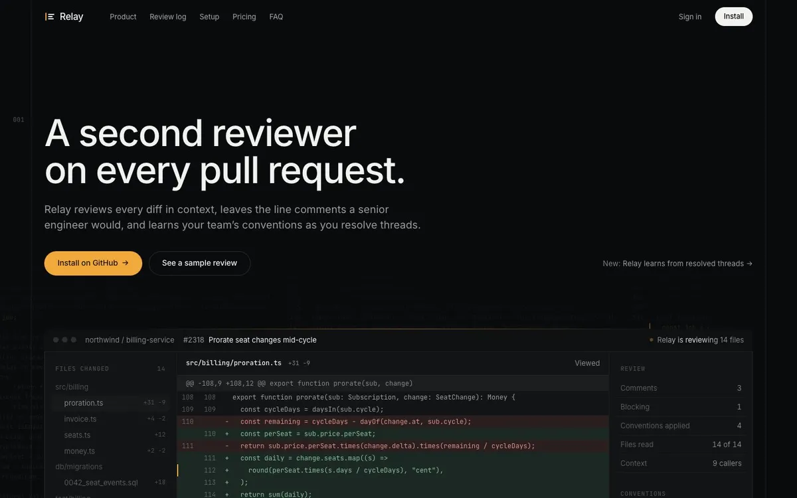
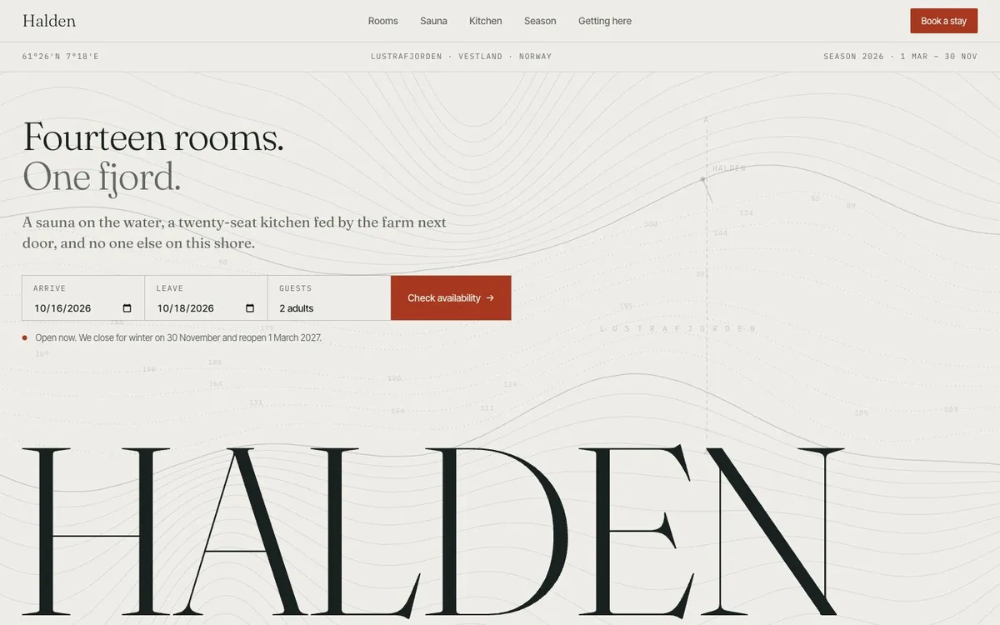
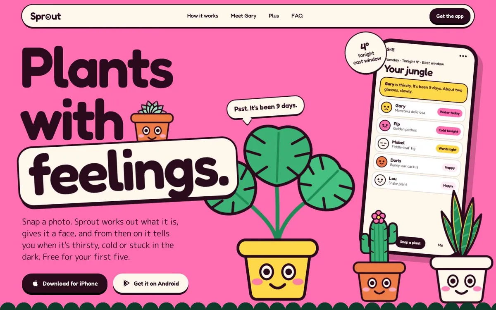
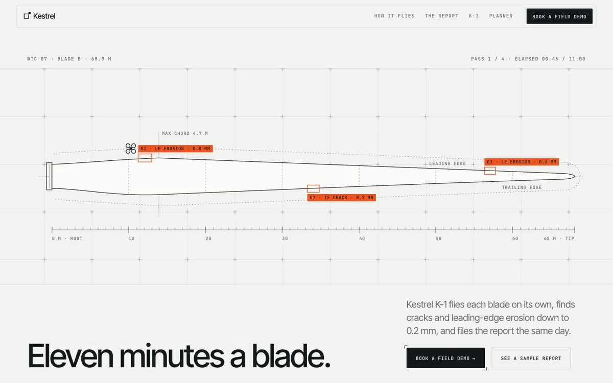
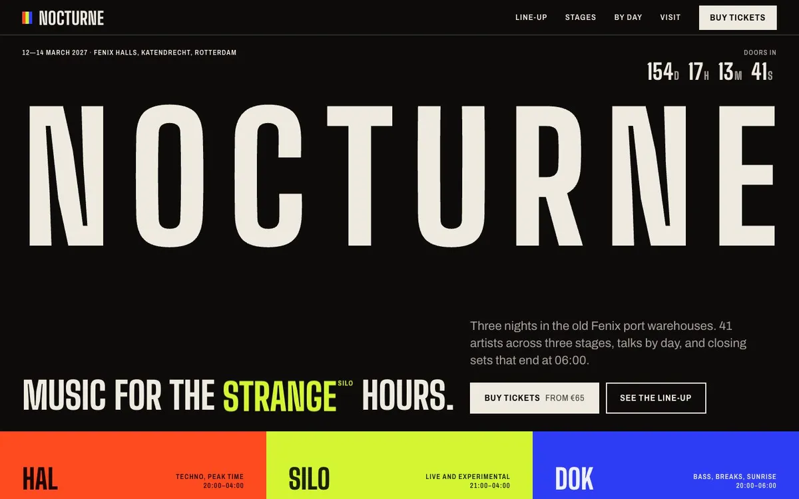
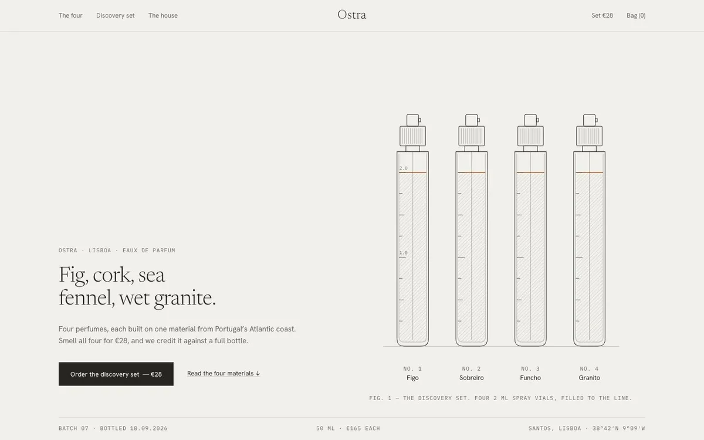
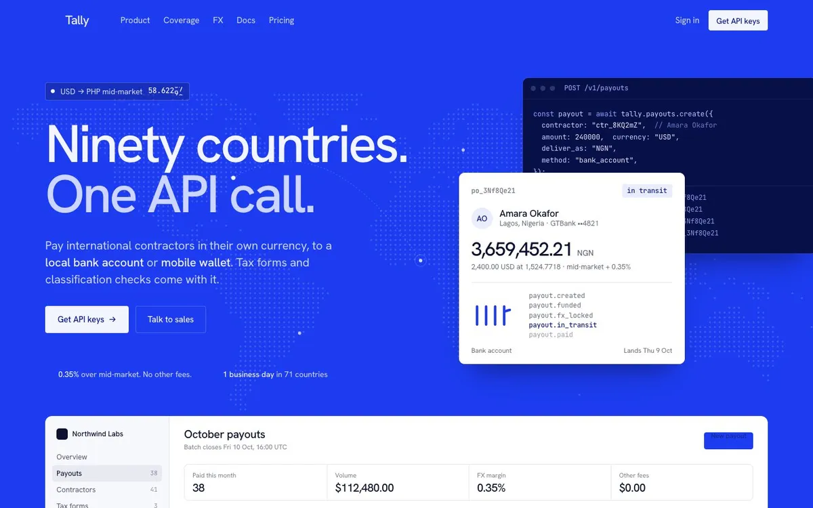
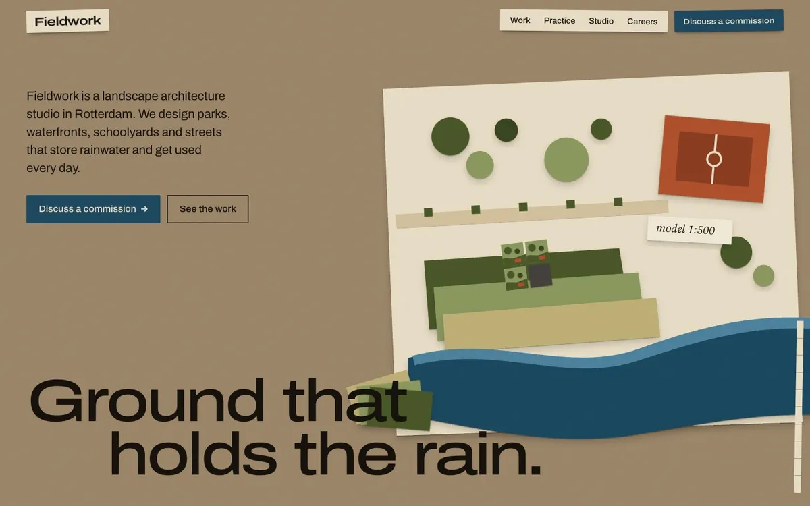
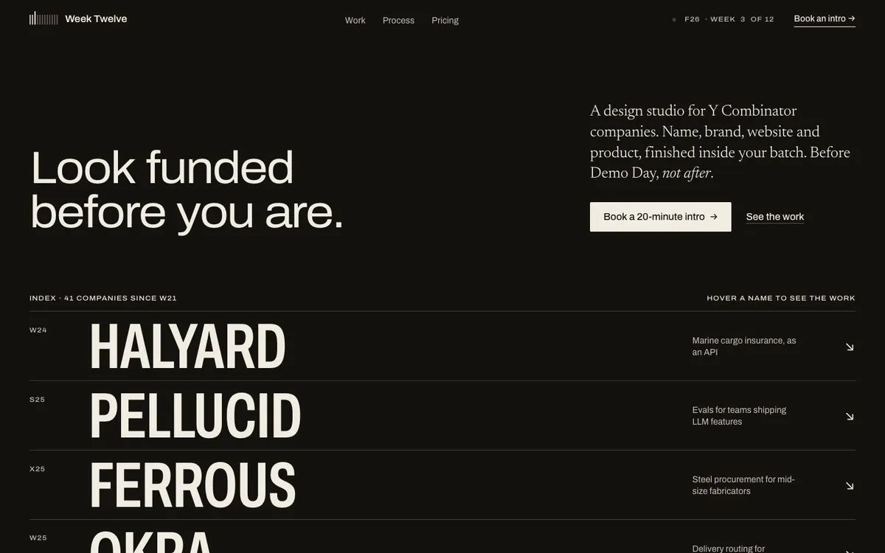

<p align="center">
  <a href="https://arjunkshah12345-hash.github.io/claudestudio-skill/"></a>
</p>

<h1 align="center">claudestudio</h1>

<p align="center">
  <b>An agent skill that makes coding agents design websites like the studios that win.</b><br>
  Every rule in it was measured from 99 live sites, not lifted from a mood board.
</p>

<p align="center">
  <a href="https://arjunkshah12345-hash.github.io/claudestudio-skill/">Website</a> ·
  <a href="#install">Install</a> ·
  <a href="#nine-briefs-nine-directions">Examples</a> ·
  <a href="skills/claudestudio/SKILL.md">SKILL.md</a> ·
  <a href="research/AGGREGATE.md">Research</a>
</p>

<p align="center">
  <a href="https://skills.sh"></a>
  <a href="LICENSE"></a>
  
</p>

---

Ask a coding agent for a landing page and you get the same page every time: a pill badge, a centered bold headline with one gradient word, two equally loud buttons, three icon cards, and purple blobs floating behind it all.

claudestudio replaces that default with a design process and a set of numbers. We loaded **99 live client sites** shipped by about **40 studios and in-house teams** (basement.studio, Work & Co, AREA 17, Exo Ape, Locomotive, Lusion, Unseen, Malvah, Linear, Stripe, Vercel, Apple and more), scrolled them with real wheel events, and read about 6,000 computed elements per page. The skill is what came out: ten design directions, measured defaults, 60 signature techniques, a list of 38 AI tells with their fixes, and an audit script that measures your build the same way.

## Install

With the [skills CLI](https://skills.sh) (Claude Code, Codex, Cursor, OpenCode and the other supported agents):

```bash
npx skills add arjunkshah12345-hash/claudestudio-skill
```

Or copy it by hand:

```bash
git clone https://github.com/arjunkshah12345-hash/claudestudio-skill
cp -R claudestudio-skill/skills/claudestudio ~/.claude/skills/claudestudio
```

Then ask for a website the way you normally would. The skill triggers on websites, landing pages, marketing sites, portfolios, stores and redesigns, and whenever you ask for something premium or "not AI-looking".

## What the agent does with it

1. **Chooses a direction and a volume.** One of ten directions (below), a register (Quiet, Confident or Loud), and five range axes: ground, type genre, image medium, composition and motion feel. This keeps two sites built with the same skill from looking alike.
2. **Writes a design spine before any code.** About fourteen lines: direction, type, scale, palette, grid, hero, imagery, motion, three sample lines of copy.
3. **Builds tokens first.** It starts from `assets/tokens.css` (fluid type scale, text-style bundles, one house ease, reduced motion) and `assets/motion.js` (reveals, split text, tickers, letter-roll, scroll-spy, clocks).
4. **Composes, rather than filling a template.** It picks from 15 hero archetypes, 22 section patterns and 60 techniques, each traced to a live site, and carries one motif through the page.
5. **Does a craft pass.** Tracking scaled to size, two-tone headings, one radius camp, a recomposed 390px layout, one bespoke detail in a boring place.
6. **Audits itself.** `scripts/audit.mjs` loads the page at 1440 and 390px, measures it against the skill's ranges and saves screenshots. The agent has to look at those screenshots and fix every FAIL before it's done.

## The gap, in numbers

| Property | Agent default | Measured on studio sites |
|---|---|---|
| Display weight | 700–800 | **300–510** (Stripe 300, Linear 510) |
| Display tracking | 0em | **−0.022em at 64px** (negative on 53 of 94 sites) |
| Words in the h1 | 11 | **4** (median) |
| Accent colours | 4–6 | **1**, under 5% of pixels |
| Hero buttons | 3, equally loud | **2 at most**, solid + ghost |
| Body colour | `#000` on `#FFF` | **`#171717` on `#FAFAFA`** |
| Reveal | fade up 40px, `ease` | **blur-in ≤12px**, `cubic-bezier(.16,1,.3,1)`, ~0.8s |
| Feature section | 3 icon cards | **chapters with real media** |

## Nine briefs, nine directions

Each example was built by a fresh agent with only this skill loaded, then audited with the skill's own script. All nine audit at **0 fail**. They're live on the [website](https://arjunkshah12345-hash.github.io/claudestudio-skill/#work), and the source is in [`examples/`](examples).

| | | |
|:--:|:--:|:--:|
| <a href="examples/relay"></a><br>**Relay** · AI code review<br><sub>Engineered Dark · Confident</sub> | <a href="examples/halden"></a><br>**Halden** · Fjord hotel<br><sub>Cinematic Place · Quiet</sub> | <a href="examples/sprout"></a><br>**Sprout** · Plant-care app<br><sub>Playful System · Loud</sub> |
| <a href="examples/kestrel"></a><br>**Kestrel** · Blade inspection<br><sub>Deep-Tech Spec · Quiet</sub> | <a href="examples/nocturne"></a><br>**Nocturne** · Music festival<br><sub>Institutional · Loud</sub> | <a href="examples/ostra"></a><br>**Ostra** · Perfume house<br><sub>Quiet Luxury · Quiet</sub> |
| <a href="examples/tally"></a><br>**Tally** · Payments API<br><sub>Ledger Light · Confident</sub> | <a href="examples/fieldwork"></a><br>**Fieldwork** · Landscape studio<br><sub>Editorial Motion · Confident</sub> | <a href="examples/week-twelve"></a><br>**Week Twelve** · Studio for YC companies<br><sub>Editorial Motion · Loud</sub> |

## Ten directions

| # | Direction | Use it for | Measured from |
|---|---|---|---|
| 1 | Engineered Dark | dev tools, AI agents, power-user apps | Linear, Raycast, Resend, Black Forest Labs |
| 2 | Ledger Light | B2B SaaS, fintech, APIs, docs | Stripe, Vercel, Mintlify, Attio, Factory, Ramp |
| 3 | Warm Paper | AI labs, thoughtful and founder-led tools | Anthropic, Cursor, Daylight, Steve Jobs Archive |
| 4 | Editorial Motion | studios, architecture, portfolios, culture | Studio D, Populous, Bennett & Clive, Atlas |
| 5 | Quiet Luxury Commerce | fashion, beauty, fragrance, objects | Aesop, Totême, Magda Butrym, Aman |
| 6 | Cinematic Place | hospitality, travel, real estate | White Desert, ERA Residence, Ace Hotel |
| 7 | Institutional | museums, nonprofits, publishers, civic | Art Institute of Chicago, Obama Foundation, Norton |
| 8 | Deep-Tech Spec | robotics, aerospace, climate, biotech | Terminal Industries, ICOMAT, Vast, Radian |
| 9 | Playful System | consumer apps, games, community | Family, MindMarket, Lando Norris |
| 10 | Immersive | launches with one hero object, campaigns | illoca, Lusion, Immersive Garden, 14islands |

## Audit your own build

The audit needs Playwright in the project you run it from:

```bash
npm i -D playwright && npx playwright install chromium
node ~/.claude/skills/claudestudio/scripts/audit.mjs ./index.html --out ./audit
```

```
✔ PASS  [type.families]      2 families: Archivo, Newsreader
✔ PASS  [type.display]       Display type within norms (174px · lh 0.84 · -0.01em · weight 600)
✔ PASS  [style.defaultLook]  Distinct from the default look (1/6 traits)
✔ PASS  [color.accent]       One accent hue
✔ PASS  [hero.ctas]          2 hero CTA(s)
✔ PASS  [mobile.overflow]    No horizontal overflow at 390px
0 fail · 0 warn · 9 pass
```

It checks font count, display tracking and leading, pure black and white, accent count, gradient text, emoji and hype copy, hero CTA count, icon-card grids, radius consistency, shadows, contrast, mobile overflow, tap targets, reduced motion and whether the page has drifted into the skill's own default look. It exits 1 on any FAIL. It can't judge taste, so the skill also makes the agent open the screenshots and run the squint, logo and template tests.

## Repository

```
skills/claudestudio/          the skill (this is what gets installed)
  SKILL.md                    workflow, six laws, measured defaults, hard bans
  references/                 directions, range, typography, color, layout, motion,
                              components, techniques, imagery, copy, anti-slop, evidence
  assets/                     tokens.css, motion.js
  scripts/audit.mjs           the 1440/390 audit with screenshots
examples/                     nine sites built with the skill, each a standalone page
site/                         the website, built with the skill (deployed to GitHub Pages)
research/                     per-cluster teardown notes, AGGREGATE.md, data.json per site
tools/                        the research tooling (analyzer, aggregation, capture)
```

The research folder holds the notes and measured data for every site. Screenshots of third-party sites are left out of the repo on purpose.

## Credits and limits

The skill distils measurements and principles from public websites. It contains no third-party code, fonts or artwork, and every studio credit was checked against case studies, footer credits or Awwwards profiles (see [`references/evidence.md`](skills/claudestudio/references/evidence.md)). Fonts on top sites are mostly licensed, so the free substitutes in the skill are judgment calls by character, not measurements. Some WebGL sites never got past their loaders in headless capture; for those, the loader, the DOM type and the mined motion values are measured, and the 3D is described from jury notes.

Sister skill for motion and launch videos: [motion-director](https://github.com/arjunkshah12345-hash/motion-director-skill).

## License

[MIT](LICENSE) © Arjun Shah
